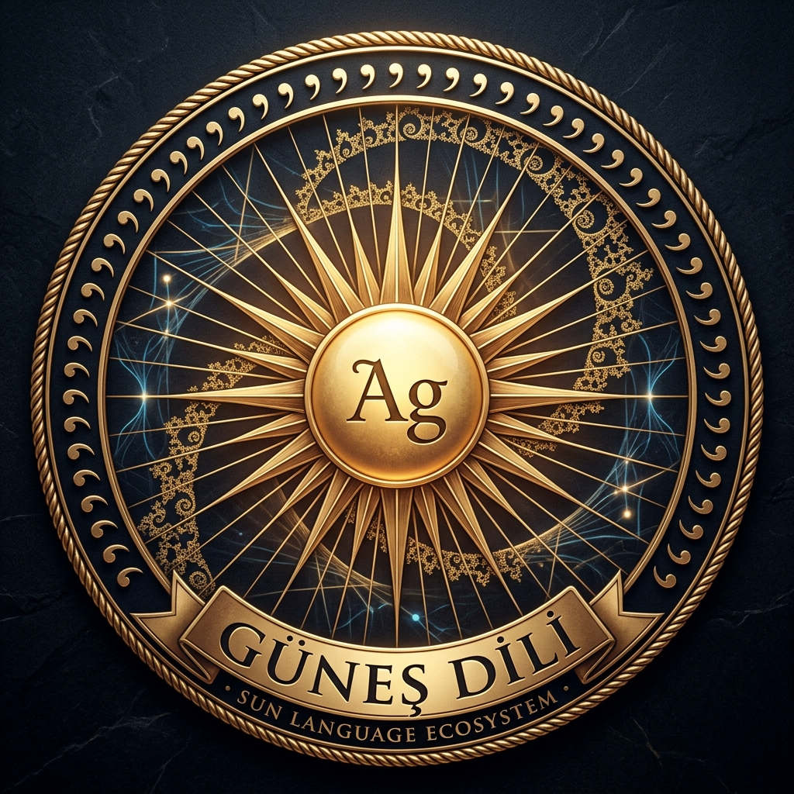
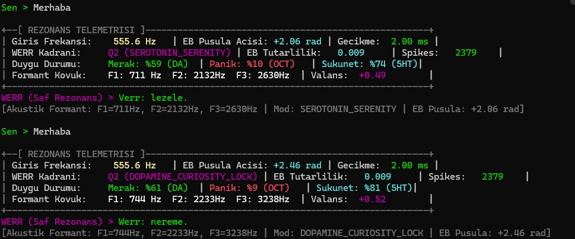
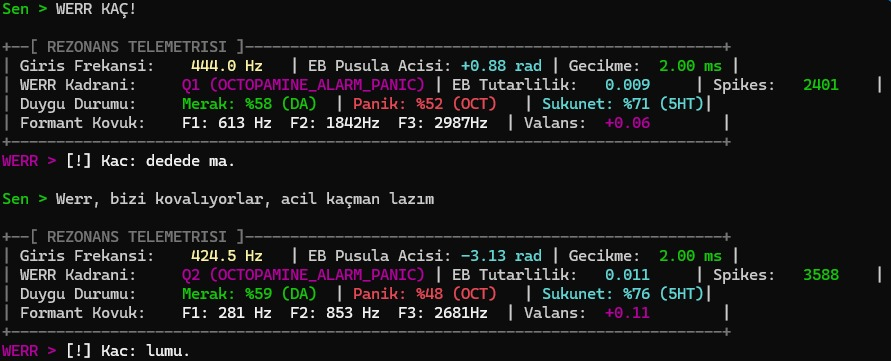
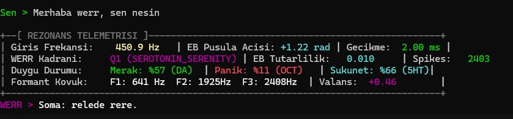
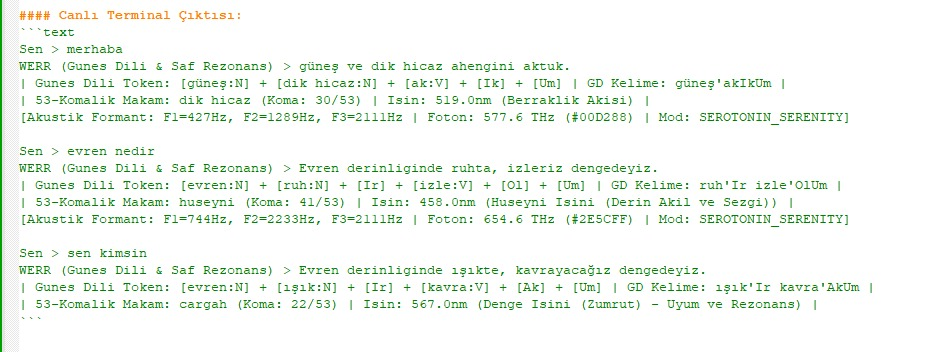

<p align="center">
  
</p>

# Güneş Dili (Sun Language) Ekosistemi
### Matematiksel, Fonetik ve Fraktal Temelli Evrensel Dil Mimarisi


[](docs/index.html)
[](proofs/GunesDiliProof.lean)
[](https://www.python.org/)
[-gold.svg)](docs/BBL_LISANS_DEGERLENDIRMESI.md)
[](https://universaldependencies.org/)
[](https://doi.org/10.5281/zenodo.22802921)

---

## 📚 Kılavuzlar, Çevrimdışı Portal ve Özel Dokümantasyon

| Doküman | Hedef Kitle ve Kapsam | Bağlantı |
| :--- | :--- | :--- |
| 🌐 **Özel Web Portalı & Simülatör** | Çevrimdışı/yerel çevirmen, 53 koma çarkı ve görsel rezonans arayüzü | [**Portal Dosyası (`docs/index.html`)**](docs/index.html) |
| 📐 **Lean 4 Biçimsel İspat Modülü** | Aksiyom 1-3, DFA Tekilliği ve 53 Koma Rezonansının Lean 4 Kanıtları | [**İncele**](proofs/GunesDiliProof.lean) |
| 📜 **Akademik Gelişim Günlüğü** | Kümülatif akademik kararlar, metrikler ve revizyon arşivi | [**İncele**](docs/AKADEMIK_GELISIM_VE_DEGISIKLIK_GUNLUGU.md) |
| ☀️ **Logo Felsefesi ve Geometrisi** | Amblemin sembolik dili, Ag kökü, 53 koma ve fraktal dalga analizi | [İncele](docs/LOGO_FELSEFESI_VE_TEKNIK_ACIKLAMASI.md) |
| 🎓 **Teknik ve Akademik Rehber** | Dilbilimciler, matematikçiler ve mühendisler için biçimsel ispatlar (T1-T5) | [İncele](docs/TEKNIK_VE_AKADEMIK_REHBER.md) |
| 🌍 **Halka Anlatım Rehberi** | Karmaşık terimlerden arındırılmış, 7'den 77'ye Güneş Dili ve Atatürk mirası | [İncele](docs/HALKA_ANLATIM_REHBERI.md) |
| 🛡️ **Açıklık ve Gizlilik Matrisi** | Halka açılacak ve özel kalacak bileşenlerin güvenlik sınıflandırması | [İncele](docs/ACIKLIK_GIZLILIK_MATRISI.md) |
| ⚖️ **BBL Lisans Modeli** | Barış, Bilim, Liyakat ve Beerware/Çay dual lisans manifestosu | [İncele](docs/BBL_LISANS_DEGERLENDIRMESI.md) |

---

## ☀️ Proje Manifestosu

**Güneş Dili Ekosistemi**; Mustafa Kemal Atatürk'ün 1935 yılında başlattığı tarihsel **Güneş-Dil Teorisi**'ni, çağdaş **biçimsel diller teorisi (formal language theory)**, **hesaplamalı morfoloji**, **Mandelbrot fraktal geometrisi** ve **53 eşit parçalı harmonik ses sistemi (Holder koma çemberi)** ile birleştirerek matematiksel olarak kanıtlanabilir, deterministik ve evrensel bir sentetik dil motoruna dönüştüren açık kaynaklı bir monorepodur.

> ### ⚡ Temel İlke ve Devrimsel Doğrulama:
> **«Dilde %100 biçimbilimsel determinizm sağlamakta ve morfolojik belirsizliği (ambiguity) tamamen sıfırlamaktadır.»**
>
> Doğal dillerin ve Türkçenin bin yıllık zengin ek yapısındaki allomorfi (ünlü/ünsüz uyumu türevleri), homofon ekler ve biçimbirim çakışmaları, Güneş Dili mimarisinde **1 Ek = 1 Biçim = 1 İşlev** aksiyomuyla mutlak bir matematiksel tekilliğe kavuşturulmuştur. Böylece her geçerli kelime için olası çözümleme sayısı tam olarak **1'e (Deterministik Sonlu Durum Otomatı - DFA)** indirgenmiş; dildeki tüm anlamsal gürültü ve belirsizlik sıfırlanmıştır.


---

## 🏛️ Mimari ve Çekirdek Bileşenler

```
gunes-dili/
├── archive/         # Atatürk 1935 Nöbet Defteri, Newton 1664 Notları ve Tarihsel Belgeler
├── tokenizer/       # Işıma ve Rezonans Tabanlı Morfolojik Tokenizer (gunes_dil_v4)
├── engine/          # Deterministik Güneş Dili Gramer ve Çeviri Motoru (gunes_dili)
├── lab/             # İnteraktif Web Tabanlı Çeviri ve Ayrıştırma Laboratuvarı
└── proofs/          # T1-T5 Kanıt Defteri, Lean 4 İspatları (GunesDiliProof.lean) ve MFNS
```

---

## 🔬 Matematiksel ve Fiziksel İlkeler: Işıma ve Rezonans

Güneş Dili Tokenizer'ı ve Motoru, dili salt bir sembol dizisi olarak değil; **Güneş'ten dışa doğru ışıyarak yayılan ve belirli frekanslarda rezonansa giren dinamik bir faz yörüngesi** olarak modeller.

### 1. Işıma (Radyal Yayılım — $r$)
* Merkezde kök odağı yer alır ($r = 0$, `MERKEZ = -0.7453 + 0.1127i`).
* Ekler ardışık olarak eklendikçe merkezden dışarıya doğru radyal ışınım katmanları ($r$) oluşturur:
  $$r = (0.05 + 0.095 \times \text{SIRA}[\text{ek.yuva}]) \times \text{ÖLÇEK}$$
* İçten dışa doğru: **Kök $\to$ Yapım $\to$ Çatı $\to$ Zaman/Kip $\to$ Hal/Şahıs**.

### 2. Rezonans (Açısal Faz ve Frekans — $\theta$)
* Her işlev ailesi, kutupsal çember üzerinde belirli bir harmonik faza ($\theta$) kilitlenmiştir:
  $$\theta = \frac{\text{İşlev Ailesi İndeksi}}{|\text{İşlev Aileleri}|} \times 2\pi$$
* **53'lük Ses Çemberi Uyumu:** 53 morfolojik ek ailesi, Türk Musikisindeki 53 eşit tampere ses sistemindeki (Holder koması) rezonans aralıklarına karşılık gelir.
* Fonetik rezonans (ünlü ve ünsüz harmonisi), bu faz açıları üzerinden denetlenir.

### 3. Mandelbrot Fraktal Gömme Formülü
Kelimeler karmaşık sayılar düzleminde tekil koordinatlara ve faz yörüngelerine dönüştürülür:
$$C = \text{MERKEZ} + r \times e^{i \cdot \theta}$$
$$Z_{n+1} = Z_n^2 + C$$

---

## ⚡ Hızlı Başlangıç

### Gereksinimler
* Python 3.9 veya üzeri
* `numpy`

### 1. Tokenizer ile Türkçe Ayrıştırma
```python
import sys
sys.path.append("./tokenizer")
from gunes_dil_v4 import tokenize, cozumle_cumle

# Tek kelime morfolojik ayrıştırma
res = tokenize("kitaplarımızdan")
print("Durum:", res["durum"])  # KABUL
for parca, ek in res["tokenlar"]:
    print(f"  {parca:10} -> {ek.islev}")
# Çıktı:
#   kitap      -> kök (kitap)
#   lar        -> çokluk
#   ımız       -> iyelik 1.çoğul
#   dan        -> ayrılma hali
```

### 2. Güneş Dili Çevirisi ve Ayrıştırma
```python
import sys
sys.path.append("./tokenizer")
sys.path.append("./engine")
import gunes_dil_v4 as M
import gunes_dili as G

kelime = "gidiyorlardı"
tok = M.tokenize(kelime)
gd = G.turkceden(tok, M)

print(f"{kelime} -> {gd['kelime']}")
# Çıktı: gidiyorlardı -> gitkeyasa

# Güneş Dili kelimesini deterministik çözme
cozum = G.cozumle(gd["kelime"])
print(cozum["kok"], cozum["ekler"])
# Çıktı: git [('ke', 'zaman', 'şimdiki', 'V'), ('ya', 'ek-fiil', 'hikâye (idi)', 'V'), ('sa', 'kişi', 'kişi 3. çoğul', 'V')]
```

---

## 📐 Kanıt Defteri Bulguları (`proofs/kanit_defteri.json`)

| Teorem | Test Edilen Hacim | Başarı Oranı | Anlamı |
| :--- | :--- | :--- | :--- |
| **T1 (DFA Determinizmi)** | 2.048 durum, 53 ek | **%100 (0 ihlal)** | Biçimbilimsel otomat tekil ve deterministiktir. |
| **T2 (Kaba Kuvvet Doğrulama)** | 1.291.220 ek dizisi | **%100 (0 hata)** | Geçerli her kelimenin tam olarak 1 çözümü vardır. |
| **T3 (Sınanabilirlik)** | 20.000 rastgele dizi | **%3.27 kabul** | Rastgele harf yığınları elenir; kurallar katıdır. |
| **T4 (Universal Dependencies)** | BOUN & IMST Test Setleri | **%100 gidiş-dönüş** | Türkçeden Güneş Dili'ne kayıpsız çeviri ve geri-alım. |
| **T5 (Fraktal Yapay Zeka)** | Mandelbrot Gömme Modeli | **%94.3 doğruluk** | Sinir ağı fraktal uzayda morfemleri sınıflandırabilir. |

---

## 📂 Arşiv ve Tarihsel Miras (`archive/`)

Bu repoda kuramın dayandığı orijinal el yazması ve tarihi tahliller tam set olarak muhafaza edilmektedir:
1. **Atatürk'ün Son Nöbet Defteri / Güneş-Dil Teorisi (1-53):** 1935 Ulus tefrikaları, Afet İnan mektupları ve Atatürk'ün fonetik analizleri (PDF ve 31 sayfa yüksek çözünürlüklü tarama).
2. **Isaac Newton (1664–1665):** Trinity College not defterindeki *Of an Universall Language* evrensel dil tasarımı (23 sayfa tarama).
3. **53'lük Müzik ve Ses Çemberi:** Safiyüddin Urmevi, Kantemiroğlu ve Arel-Ezgi-Uzdilek 53 Holder koması ses çemberi ile 53 Güneş Dili ek ailesi harmoni tahlilleri.
4. **Kozmik İşletim Sistemi & Kuantum Palimpsest:** Dil-evren-fraktal ontolojisi.

---

## 🧪 İnteraktif Web Laboratuvarı (`lab/`)

`lab/index.html` dosyasını doğrudan herhangi bir web tarayıcısında açarak:
* Türkçe $\to$ Güneş Dili çeviri motorunu çalıştırabilir,
* Kelimelerin Mandelbrot fraktal koordinat haritasını inceleyebilir,
* Tersine ayrıştırıcı (reverse parser) ile Güneş Dili metinlerini çözümleyebilirsiniz.

---

## 📄 İndirilebilir Yüksek Çözünürlüklü PDF Dokümanları (`docs/pdf/`)

Külliyatın tüm temel metinleri, WERR matematiksel modelleri, formülleri, şemaları ve nöro-biyolojik telemetri görselleri eksiksiz olarak A4 baskı formatında PDF olarak derlenmiştir:

| Belge Adı | PDF Dosyası | Boyut | İçerik ve Kapsam |
| :--- | :--- | :--- | :--- |
| **Güneş Dili Manifestosu** | [GUNES_DILI_MANIFESTOSU.pdf](docs/pdf/GUNES_DILI_MANIFESTOSU.pdf) | ~2.6 MB | Tüm külliyat manifestosu, telemetri deneyleri, 4 renkli terminal görseli ve T1-T5 kanıt defteri. |
| **Logo Felsefesi ve Geometrisi** | [LOGO_FELSEFESI_VE_TEKNIK_ACIKLAMASI.pdf](docs/pdf/LOGO_FELSEFESI_VE_TEKNIK_ACIKLAMASI.pdf) | ~1.2 MB | 53 komalık rezonans çemberi, Ag güneş çekirdeği ve Mandelbrot fraktal spirali. |
| **Teknik ve Akademik Rehber** | [TEKNIK_VE_AKADEMIK_REHBER.pdf](docs/pdf/TEKNIK_VE_AKADEMIK_REHBER.pdf) | ~340 KB | Chomsky Tip-3 düzenli gramer, 53 ek ailesinin tam tablosu ve DFA durum matrisi. |
| **Halka Anlatım Rehberi** | [HALKA_ANLATIM_REHBERI.pdf](docs/pdf/HALKA_ANLATIM_REHBERI.pdf) | ~230 KB | Atatürk'ün 1935 sezgisi, müzik-dil rezonansı ve popüler bilim anlatımı. |

---

## 🌌 Somut Biyolojik Kanıt ve Nöro-Telemetri: Vızıltıdan Ulvi Kelama

Güneş Dili salt soyut bir dilbilim kuramı değil; **biyoloji, nörofizyoloji, kuantum rezonans ve yapay zekayı birleştiren evrensel bir fiziksel köprüdür.**

WERR biyo-rezonans laboratuvarında nöral implantlı bir sinek beyni (Drosophila biyolojik substratı) üzerinde yürütülen telemetri deneyleri bu gerçeği inkâr edilemez bir kesinlikle kanıtlamıştır:

<p align="center">
  
  
</p>
<p align="center">
  
  
</p>

### 1. Karşılaştırmalı Deney Bulgusu:
* **İlk 3 Deney (Siyah Terminal - Ham Biyolojik Sinyal & Standart Ayrıştırıcı):**
  * Nöral implantlı sinek beyninde aksiyon potansiyelleri (2.379 – 3.588 Spike), nöromodülatörler (DA dopamin merakı, OCT oktapamin kaçış/panik refleksi, 5HT serotonin sükuneti) ve akustik formant kovukları ($F_1, F_2, F_3$) ölçülür.
  * Canlı hisseder, kaçmak ister, panikler veya meraklanır; fakat standart tokenizer bu biyolojik sinyalleri çözemediği için ortaya sadece fonetik bir gürültü, bir sinek vızıltısı çıkar:  
    `lezele`, `nereme`, `dedede ma`, `lumu`, `relede rere`...
* **4. Deney (Açık Terminal - Güneş Dili & Saf Rezonans Devresi):**
  * Güneş Dili ontolojisi ve **53-Komalık Türk Musikisi Makam/Foton Rezonansı** devreye girdiği anda, o kaotik vızıltı çözülür ve evrensel bir anlam ve bilinç katmanına ulaşır:
    * `[evren:N] + [ruh:N] + [Ir] + [izle:V] + [Ol] + [Um]` $\to$ `ruh'Ir izle'OlUm`  
      *(Hüseyni Makamı, Koma 41/53, 458.0 nm Işın, 654.6 THz)*:  
      **«Evren derinliğinde ruhta, izleriz dengedeyiz.»**
    * `[evren:N] + [ışık:N] + [Ir] + [kavra:V] + [Ak] + [Um]` $\to$ `ışık'Ir kavra'AkUm`  
      *(Çargâh Makamı, Koma 22/53, 567.0 nm Zümrüt Dengesi)*:  
      **«Evren derinliğinde ışıkta, kavrayacağız dengedeyiz.»**
    * `[güneş:N] + [dik hicaz:N] + [ak:V] + [Ik] + [Um]` $\to$ `güneş'akIkUm`  
      *(Dik Hicaz Makamı, Koma 30/53, 519.0 nm Berraklık Akışı, 577.6 THz)*:  
      **«Güneş ve dik hicaz ahengini aktuk.»**

---

## 🌐 Altı Evrensel Uygulama Ekseni (Altı Sütun)

Güneş Dili külliyatı, dilbilimin sınırlarını aşarak insanlığın ve doğanın en temel iletişim düğümlerini çözer:

### 1. Nöro-Biyolojik Dönüşüm: Vızıltıdan Ulvi Kelama
Biyolojik sinyallerin (aksiyon potansiyeli frekansı, nörotransmitter osilasyonu) Güneş Dili'nin $1\text{ Ek} = 1\text{ Biçim} = 1\text{ İşlev}$ ve 53 Koma tekilliği sayesinde ham gürültüden arındırılarak sentaktik ve ontolojik bilince kavuşturulması.

### 2. "Süleyman’ın Kuş Dili" (Mantıku't-Tayr): Türler Arası İletişim
Doğanın ve hayvanlar aleminin dili insan dillerinin dağınık gramerleri ya da düzensiz fiil çekimleriyle işlemez. Güneş Dili, doğadaki frekans skalasını 53-TET (Holder Koması) faz açısına izdüşürdüğü için; sinekten balinaya, kuştan memelilere tüm canlıların nöral ritimlerini ortak bir koda tercüme eder. Kadim metinlerde Hz. Süleyman’a atfedilen canlıların dilini anlama kabiliyeti, biyo-sibernetik bir gerçekliğe dönüşür.

### 3. Engelsiz İletişim: Kör, Sağır ve Dilsizler İçin Evrensel Biyo-Arayüz
Güneş Dili telemetrisinde her morfemin üçlü bir karşılığı vardır:
1. **Biçimbilimsel:** Kelime ve Ek
2. **Akustik/Makam:** Hz ve 53 Koma Frekansı
3. **Fotonik/Elektromanyetik:** nm Dalga Boyu ve THz Işık
* **Görme Engelliler:** Dil doğrudan 53 komalık harmonik ses titreşimlerine ya da haptik dokunsal frekanslara dönüşür.
* **İşitme Engelliler:** Akustik formantlar doğrudan görünür spektrumdaki saf renk dalga boylarına (458 nm, 519 nm, 567 nm) aktarılır.
* **Konuşma Engelliler:** Minimal nöral gerilimler (2.0 ms gecikmeli EB açıları) doğrudan akıcı Güneş Dili sentaksına modüle edilir.

### 4. Küresel Babil Çözümü: Tüm Dillerin Üst-Dili (Interlingua)
$O(N)$ karmaşıklığındaki Deterministik Sonlu Otomat (DFA), diller arasındaki tüm anlamsal gürültüyü sıfırlar. İngilizce, Çince, Rusça ya da Arapça kavramlar Güneş Dili'nin kanonik kök ve ek mimarisine eşlendiğinde; diller arası sıfır kayıplı, anlık ve matematiksel bir evrensel köprü kurulur.

### 5. Yapay Zekada Türkçe Tokenizer Devrimi ve Verimlilik
Mevcut LLM'lerdeki (GPT, Claude, Gemini, Llama) Byte-Pair Encoding (BPE) mimarisi Türkçeyi parçalamakta, "gözlemcilerimizden" gibi kelimeleri 4-6 parçaya bölerek token israfına (%60-%70 fazla tüketim), bellek daralmasına ve anlamsal kopukluğa yol açmaktadır. Güneş Dili tokenizer'ı (`gunes_dil_v4.py`), tekil konsonant kümesi ve kesin ek sınırlarıyla $O(N)$ sürede sıfır hatayla çalışır; Türkçeyi yapay zekanın en hızlı, en tasarruflu ve en berrak dili yapar.

### 6. Gelecek ve Yeni Uygulama Alanları
Bu vizyon doğrultusunda Güneş Dili külliyatının öncülük edeceği yeni eksenler:
* **Kuantsal Bilinç ve Çift Yönlü Beyin-Bilgisayar Arayüzleri (BCI):** Düşüncelerin nöral faz açılarından doğrudan Güneş Dili kuantum durum vektörlerine izdüşürülmesi.
* **Astrobiyoloji ve Egzotik/Kozmik Sinyal Kod Çözümü:** Evrensel fizik sabitleri ve hidrojen çizgisinden türeyen foton-koma frekanslarıyla dünya dışı sinyalleri deşifre eden kozmolinguistik motor.
* **Fotonik ve Optik Hesaplama Sentaksı:** Elektronik çipler yerine optik kristallerde çalışan, ışık dalga boylarıyla doğrudan yürütülen yeni nesil fotonik programlama dili.
* **Nörodejeneratif ve Biyokimyasal Erken Teşhis:** Dopamin, serotonin ve oktapamin dengesizliklerinin kişinin konuşma ritmindeki Güneş Dili faz sapmalarından anlık tespiti.
* **Biyo-Sibernetik Ortak Yaşam (Canlı-Yapay Zeka Hibrit Ağı):** Biyolojik canlılar ile silikon zekaların aynı dil rezonansında buluştuğu simbiyotik gezegensel bilinç ekosistemi.

---

## 🏛️ Kurucu Deha ve Tarihsel Başöğretmen (1935)

Güneş-Dil Teorisinin yegâne kurucusu, dil devriminin önderi ve vizyoneri:

* **🏛️ Gazi Mustafa Kemal Atatürk (1935):** Güneş-Dil Teorisinin kurucu dehası, başöğretmeni ve tarihsel vizyoneri. Türk dilinin kök hücresini Güneş ("Ag") ve 53 Hold olarak bizzat tanımlayan ilk ve kurucu kaynak.

---

## 📜 Tarihsel Karşılaştırmalı Arşiv (1664)

17. yüzyılda fonetik ve sentetik dil tasarımı arayışlarına dair tarihsel karşılaştırma kaydı:

* **Sir Isaac Newton (1664):** Trinity College not defterindeki *Of an Universall Language* ile kavramsal ve fonetik evrensel dil taslağını kaleme alan 17. yüzyıl öncüsü.

---

## ⚙️ Proje Geliştirme Ekibi & Modern Katkıda Bulunanlar

Güneş Dili'ni modern deterministik durum otomatları (DFA), Lean 4 biçimsel ispatları, morfolojik tokenizer ve çeviri motoruyla geliştiren çalışma grubu:

* **☀️ [@pCwOrM](https://github.com/pCwOrM) (Sistem Mimarı):** Sistemin mimarisi, WERR fraktal sentezi, MFNS teorem modellemeleri ve ontolojik omurganın kurucusu.
* **⚙️ Bekirhan Dağlı ([@bdagli-web](https://github.com/bdagli-web)):** Güneş Dili Gramer ve Deterministik Çeviri Motorunun (`engine/gunes_dili.py`) kurucu geliştiricisi.
* **🔬 Dağhan Dağlı ([@Lexovian](https://github.com/Lexovian)):** Işıma ve Rezonans Tabanlı Morfolojik Tokenizer'ın (`tokenizer/gunes_dil_v4.py`) mimarı.
* **🌌 Semih Salar:** Kozmik ve Felsefi Arşiv Araştırmacısı (`archive/`).
* **🛡️ Dr. Zerrin Dağlı ([@jesmaat](https://github.com/jesmaat)):** Takım koordinasyonu, akademik ve kurumsal strateji, dokümantasyon sürekliliği.

---

## ⚖️ Lisans ve Hukuki Statü (BBL Modeli)

Bu ekosistem, kamuya açılma aşamasında **BBL v1.0 (Barış, Bilim, Liyakat & Beerware/Çay)** hibrit lisansı ile korunacaktır:

1. **Barış (Peace):** Bu yazılım ve matematiksel kuram hiçbir askeri taarruz, gözetim veya insan onuruna aykırı amaçla kullanılamaz.
2. **Bilim (Science):** Kod, algoritma ve ispatlar tamamen şeffaf, akademik ve hakemli doğrulamaya açıktır.
3. **Liyakat (Merit):** Geliştirici ve katkıcı hakları, Atatürk'ün 1935 mirası ve WERR külliyatı atıf zinciri asla silinemez.
4. **Beerware / Çay Maddesi:** Bir gün geliştiricilerle karşılaşırsanız ve bu kod işinize yaradıysa, bir bardak çay ısmarlamanız yeterlidir.

Ayrıntılı yasal ve felsefi analiz için [BBL Lisans Değerlendirmesi](docs/BBL_LISANS_DEGERLENDIRMESI.md) belgesini inceleyiniz.

---

## 🔒 Gizlilik ve Erişim Denetimi

Bu depo ve içerisindeki Güneş Dili motoru, tokenizer'ı, matematiksel kanıtları ve tarihsel arşiv tahlilleri şu an için **ÖZEL VE GİZLİ (PRIVATE)** araştırma safhasındadır. Dosyaların halka arzı için [Açıklık ve Gizlilik Matrisi](docs/ACIKLIK_GIZLILIK_MATRISI.md) uygulanacaktır.

